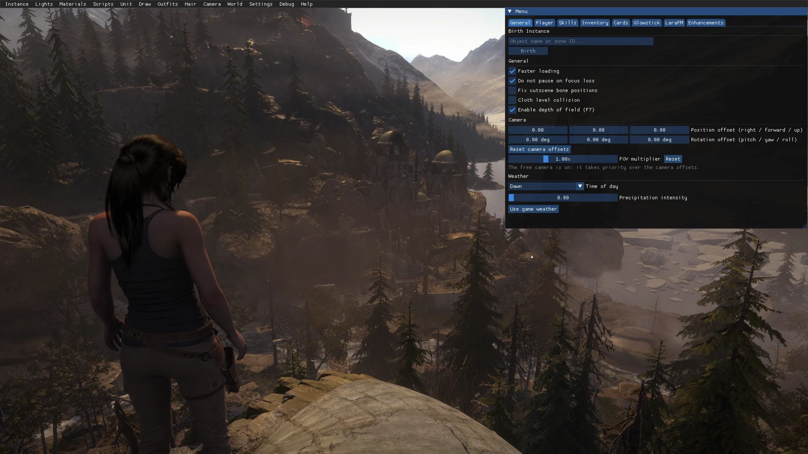
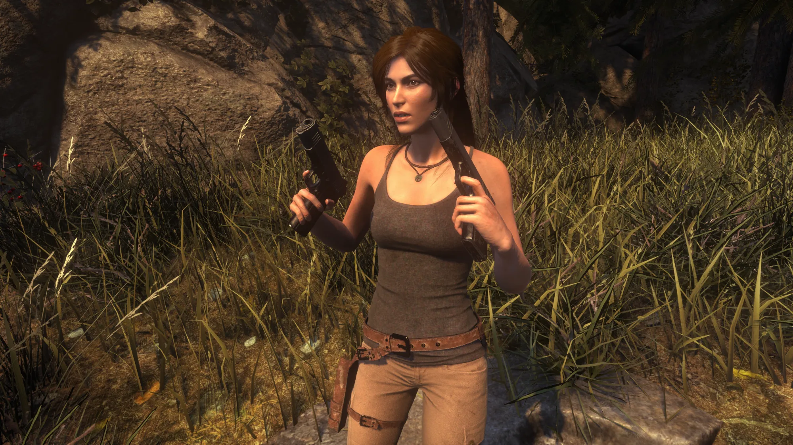
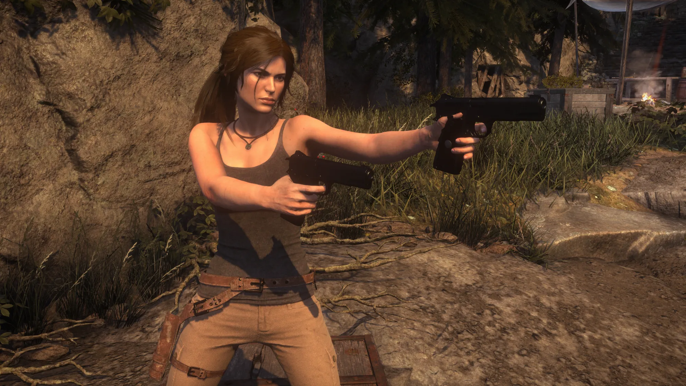
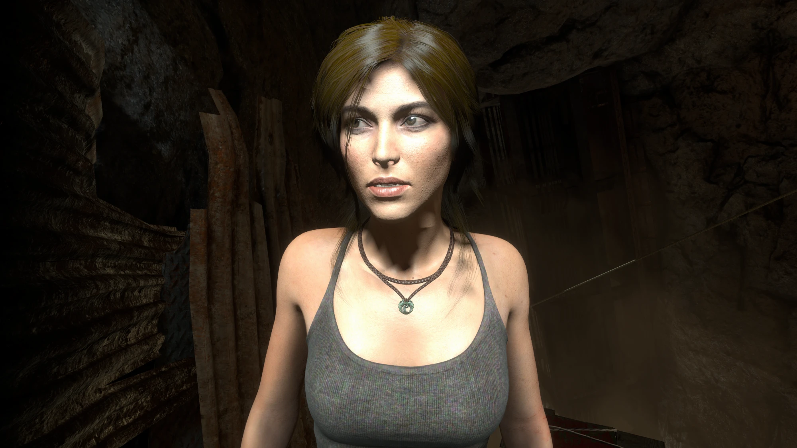
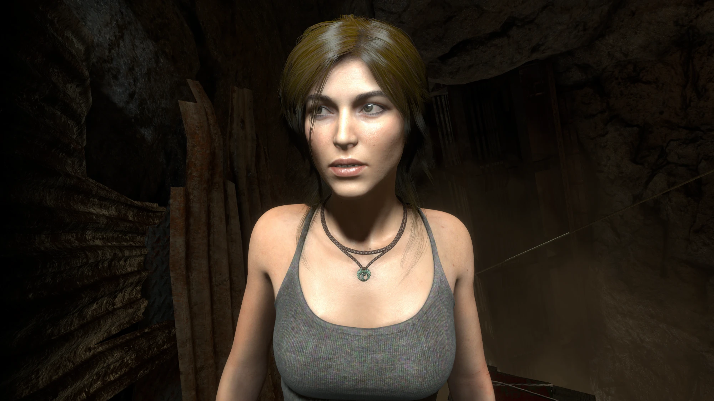

# ROTTRFramework



A mod framework for **Rise of the Tomb Raider** (PC, Steam; DX12 and DX11). It loads into the game as an `.asi` and adds an in-game menu (**F8**), new gameplay, modding tools for outfits, cutscenes and levels, and fixes for engine bugs.

Current version: **1.0.0**

## Features

Everything is in the in-game menu (**F8**) unless a hotkey or file is given.

### Player (Player tab)
- **Invulnerability**, **Infinite health**, **Infinite ammo**, **Infinite resources**
- **One-hit kill**: any damage is lethal to everything but Lara
- **Moon jump**: much higher jumps
- **Fly mode** (F2)
- **Kill Lara anytime** (F11, or the Kill Lara button) and a **Deathfade delay** (how long before the reload after a death)
- **Player position**: read and set Lara's position
- **Glowstick** (Glowstick tab): take the glowstick into Lara's hand anywhere, hang it on her belt or let go of it; any colour for it (and the flare) instead of the game's blue / amber, and a brightness of your own that the levels don't change (colour and brightness contributed)
- **Lock player input** (F5), for example while the free camera is on

### Combat and movement (Enhancements tab, Inventory tab)
- **Dual wielding** pistols (Inventory > Weapons)
- **Silencer toggle**: press a weapon's key again to take its silencer off or put it back on, as in Tomb Raider 2013, at once without Lara's reload
- **No upgrade looks** (Inventory > Weapons): every weapon keeps its default look, as before its first upgrade (the upgrades still work; attachments such as suppressors keep theirs)
- **Weapon variants**: equip, unlock or remove any bow, pistol, SMG or shotgun variant
- **Equipment** (Inventory > Equipment): give or take away any item of the campsite's Equipment list (quivers, pouches, satchel, rucksack, bandolier, rebreather, ascender, lock pick, ...)
- **Air aim**: aim, shoot and use the combat stance while jumping or falling, faster shooting in the air, shooting during evades and on balance beams, arms that aim at the target
- **Slow motion** button with its own world and Lara speeds and an optional Survival Instinct view, plus an **aim camera**
- **Acrobatics**: Black Widow-style flips on combat evades, an acrobatic chain on the roll, enemy shots that miss during rolls and evades, strafing (crouched near cover too) and an acrobatic climb-up
- **Grapple kick**: zip to an enemy at range and finish with a kick
- **Hand-to-hand combat**: chains of punches and kicks
- **Enemy behaviour**: fire tokens, so that enemies don't all shoot Lara at once
- **Free underwater swimming**: swim where the camera points, up and down keys, and breath tuning
- **Gameplay** (Enhancements tab): no tutorial hints or "basecamp / tomb discovered", "tomb nearby" notifications; switching weapons without Lara drawing the new one; campsites usable near enemies; the weapon select at the bottom left, at a size of your choice
- **Lara's gear** (Player tab): her lower gear, upper gear (with her quiver), body gear (bandolier, rucksack, satchel) and quiver strap hidden for every outfit

#### Dual wielding pistols (Inventory > Weapons)

| Drawing both pistols | Aiming with both |
|---|---|
|  |  |

### Progression and world
- **Skill editing** (Skills tab): give or remove any skill, all skills at once, and skill points
- **Card enabler** (Cards tab): turn any Expedition card on or off, with search
- **Weather editor** (General tab): time of day and precipitation intensity, changed at once (the sky, the level's time-of-day events and each area's lighting, without a checkpoint reload)
- **Game time scale** and **pause** (World menu, F3)
- **Unit selector** (Unit menu): load any level unit or Chapter Select entry by name or ID
- **Birth Instance**: spawn any game object by name or zone ID
- **LaraFM** (LaraFM tab): your own music (mp3, m4a, mp4, aac, wav, flac, wma, ogg in `ROTTRFramework\LaraFM`) on Lara's own radio (her walkie-talkie: without it in her inventory, no music; the tab gives her one), with a radio sound, muffled while her radio is under water; a load stops it; the arrow keys play, pause and change tracks

### Camera and display
- **Free camera** (F4) with adjustable speed and mouse sensitivity
- **Gameplay camera settings** (General tab): position and rotation offsets, a field-of-view multiplier, and depth of field on or off (F7)
- **Hide UI** (F6)
- **Draw instances**, **Draw triggers** and **Draw markup**, with labels, a legend and distance limits (Draw menu)
- **Draw wireframe** (Draw menu): the triangles' edges over the game's picture, or on flat surfaces (Lines only), in a colour and opacity of your own, see-through and with back faces if wanted

### Editors
- **Instances window**: browse the level's instances, go to one, bring it to Lara, delete it, edit its transform, and highlight the selected one. Its tabs:
  - **Drawgroup toggler**: show or hide each drawgroup
  - **Cloth editor**: live cloth settings (wind, collision, collision with hair)
  - **Collision editor**: the collision capsules that cloth collides with
  - **Marker editor**: live editing of collision markers
  - **Animation previewer**: play any animation clip on the instance, with looping
- **Light Editor**: edit the level's lights live (on/off, placement, shading, shadows, indirect lighting), duplicate them or add new ones
- **Material Editor**: live material editing (parameters, textures, every constant), highlight a material by hovering, save as `.tr10material`
- **PureHair Editor**: hair look, motion, strands and advanced settings; Lara's hair can be locked to one motion profile, whatever she does
- **Cloth level collision**: cloth collides with the level
- **Cloth underwater settings**: the wet cloth configuration used underwater

### Outfits and mods
- **Outfit switch** (Outfits menu, or F9 for the next outfit), with search and per-outfit part toggles
- **No cutscene outfit changes**: the story keeps your outfit on
- **Custom outfits** from `ROTTRFramework\outfits\` (`.ini` files, folders or `.zip` packages, `mod.json` toggles for mesh parts). Outfits with new models are built into `bigfile._mod.rottrframework.000.000.tiger`
- **Mods** from `ROTTRFramework\mods\` (a folder with `mod.json`, or a `.zip`), as the ROTTR Modding Suite makes and installs them; mods still in the game folder's old `mods\` folder are read too
- **Mod sounds**: sounds that replace the game's, and each outfit's own Lara voice (efforts, pain and death sounds) and voice settings
- **Cutscene subtitles** from mods
- **Lua scripting**: scripts in `ROTTRFramework\` or shipped with an outfit can add their own menu tabs (Scripts menu: reload)

### Cutscenes and Extras
- **Extras** in the main menu, with a **Cutscene Viewer** (any cutscene picked from a list as the game's Relics are, in any outfit chosen from a grid of their pictures, with titles in the game's 15 text languages and framed pictures) and a **Model Viewer** (the game's objects in a 3D view, studio-lit, with music; the pictures of its grid come with the framework, and models that mods add get theirs from the ROTTR Modding Suite: Models → For the Model Viewer → Make the pictures)
- **Cutscene bone positions fixer**: stops cutscenes from overriding a model's own skeleton

### Engine
- **Up to 8191 bones** skinned in a model
- **8 weights per vertex**: the game's skinning shaders are rewritten at runtime
- **Larger blendshape buffer** (10 MB → 64 MB by default) with an overflow guard: no corrupted faces on large models in cutscenes
- **PureHair strand layouts** PH64, PH128 and PH256
- **DX12 renderer fix**: stops black terrain, faces and trees with tessellation on (a bug in the game itself, seen on NVIDIA drivers 572 and later)
- **DLAA**: DLSS at full resolution, used only for anti-aliasing: an entry of the game's own Options > Display > DLSS list (Off, DLAA, Quality, Balanced, Performance, Ultra Performance), switched at once like the others
- **Graphics past the game's options** (Enhancements > Graphics): LOD and foliage LOD distance, sun shadow distance and sharpness, larger shadow maps for each light, softer lamp shadows, contact shadows, ray-traced lamp and sun shadows (DirectX Raytracing), fog distance, the hair's self-shadow distance (its flicker), and the skin's subsurface scattering in gameplay, not only in cutscenes
- **Faster loading**: skips the intro logos, speeds up startup, level loads and the main menu's loads (on by default)
- **Do not pause on focus loss**: the game keeps running in the background (on by default)
- A faster main menu (the Steam save check is cached; a save the fast start missed is read again, so CONTINUE never shows "EMPTY"), and crash details in the log (crash reports and dumps in `ROTTRFramework\CrashDumps`)
- **Languages in game**: Options > Audio's voice and text languages can be changed during play, not only at the main menu; Lara's grunts follow the new voice language at once

#### Graphics: the game's own and with ROTTRFramework (Enhancements > Graphics)

| The game's own | With ROTTRFramework |
|---|---|
|  |  |
| Shadow map size: x1<br>Lamp shadow softness: Off<br>Contact shadows: Off<br>Skin scattering: Off | Shadow map size: x8<br>Lamp shadow softness: Softest<br>Contact shadows: Strong, length 30 cm<br>Skin scattering: On |

### Interface and tools
- **ImGui menu** (F8; Shift+F8 keeps it on screen while you play), **UI scaling** and three themes
- **Diagnostics** window (Debug menu): frame rate and which features are available on this game build
- **Live link** to the ROTTR Modding Suite (edits shown in the game at once). The Suite is not part of this repository.

### Hotkeys

| Key | Action |
|---|---|
| F2 | Fly mode |
| F3 | Pause |
| F4 | Free camera |
| F5 | Lock player input |
| F6 | Hide UI |
| F7 | Depth of field |
| F8 | Menu (Shift+F8: keep it on screen while you play) |
| F9 | Next outfit |
| F11 | Kill Lara |
| Up / Down / Left / Right | LaraFM: play / pause / previous track / next track (in play) |

## Install

1. Build the framework (see below).
2. Copy `ROTTRFramework.asi`, `faultrep.dll` and the `ROTTRFramework\` folder from `package\` into the game folder, next to `ROTTR.exe`.
3. Start the game and press **F8** for the menu.

The log is written to `ROTTRFramework.log` and settings are kept in `ROTTRFramework.ini`, both in the game folder.

`faultrep.dll` is a small loader: the game imports `faultrep.dll`, and this copy loads the `.asi`. Windows Defender sometimes flags it as a false positive.

## Settings

Most options are in the F8 menu, which writes them to `ROTTRFramework.ini`. Some useful entries:

| Section | Key | Default | What it does |
|---|---|---|---|
| `[Weapons]` | `DualWieldPistols` | `1` | Dual-wield pistols |
| `[Weapons]` | `SilencerToggle` | `1` | Pressing the weapon's key again toggles the silencer |
| `[Weapons]` | `SilencerNoReload` | `1` | The silencer toggle without Lara's reload |
| `[Weapons]` | `NoUpgradeLooks` | `0` | The weapons drawn without their upgrades' looks |
| `[Rendering]` | `BlendShapeBufferMB` | `64` | Blendshape (facial morph) buffer size, 10 to 512 MB; the game's own is 10 MB |
| `[Rendering]` | `LodDistance` | `1` | How far detailed models are kept (x0.5 to x8) |
| `[Rendering]` | `ShadowDistance` | `1` | How far the sun casts shadows: its last shadow cascade's end and the objects' own shadow ranges (x0.5 to x8) |
| `[Rendering]` | `ShadowSharpness` | `1` | Sharper sun shadows close by: its nearest cascades cover less ground (x1 to x4) |
| `[Rendering]` | `FogDistance` | `1` | Where the distance fog starts and ends (x0.5 to x4) |
| `[Rendering]` | `HairSelfShadowOffset` | `8` | Keeps Lara's hair from shadowing itself (its flicker) while it still shadows her and the ground (0 to 64; 0: the game's own) |
| `[Hair]` | `StrandLayout` | *(empty)* | PureHair strand layout: `Stock`, `PH64`, `PH128` or `PH256` |
| `[Hair]` | `LockedMotionProfile` | *(empty)* | The hair motion profile (its name) Lara's hair always uses; empty: the game chooses |
| `[Draw]` | `WireframeStyle` | `0` | Draw wireframe: 0 the lines over the game's picture, 1 lines only (flat surfaces) |
| `[Draw]` | `WireframeColor` / `WireframeBackground` | `0.35 0.85 1 1` / `0.08 0.08 0.09` | The lines' colour and opacity / Lines only's surfaces (linear, before the game's exposure) |
| `[Draw]` | `WireframeSeeThrough` / `WireframeBackFaces` | `0` | The lines of hidden surfaces too / of back-facing triangles too |
| `[Loading]` | `FasterLoading` | `1` | Skips the intro logos and speeds up startup and level loads |
| `[Loading]` | `BackgroundThreads` | (auto) | Threads for the game's background jobs (the loads' decompression): without the key, half the CPU's threads with FasterLoading on; `2` is the game's own |
| `[Loading]` | `SampleThreads` | `0` | Diagnostics: samples every thread during loads and logs where the time went (`LoadSample:` lines) |
| `[General]` | `DoNotPauseOnFocusLoss` | `1` | Keeps the game running when its window loses focus |
| `[Outfits]` | `NoCutsceneOutfitChanges` | `0` | The story no longer changes Lara's outfit |
| `[Gameplay]` | `HideHints` | `0` | No tutorial hints and no discovery notifications |
| `[Gameplay]` | `NoDrawOnSwitch` | `0` | Switching weapons only chooses one; Lara does not draw it |
| `[Gameplay]` | `HideLowerGear` / `HideUpperGear` | `0` | Lara's lower / upper gear not drawn, whatever the outfit |
| `[Gameplay]` | `HideBodyGear` / `HideQuiverStrap` | `0` | Draw groups 46-48 (bandolier, rucksack, satchel) / 12 (quiver strap) not drawn |
| `[Gameplay]` | `WeaponSelectBottomLeft` | `0` | The HUD's weapon select at the bottom left |
| `[Gameplay]` | `WeaponSelectSize` | `65` | Its size there, percent of the game's (30 to 100) |
| `[LaraFM]` | `Volume` | `0.8` | LaraFM's volume (0 to 1) |
| `[LaraFM]` | `RadioEffect` | `1` | How much it sounds like a radio (0: the music as it is) |
| `[LaraFM]` | `Shuffle` | `1` | Next picks a random track |
| `[LaraFM]` | `ArrowKeys` | `1` | The arrow keys control LaraFM in play |
| `[LaraFM]` | `UnderwaterMuffle` | `1` | The music sounds muffled while her radio is under water |
| `[LaraFM]` | `UnderwaterVolume` | `1` | How loud the muffled music is (0.25 to 1.5) |
| `[LaraFM]` | `PlayInCutscenes` | `1` | The music goes on during cutscenes (0: paused until the cutscene ends) |

`BlendShapeBufferMB` and the `[Hair]` settings (but `LockedMotionProfile`) are read once at startup, so changes to them take effect the next time the game starts.

## Build

You need Visual Studio 2026 with **Desktop development with C++** and the **C++ CMake tools**. All libraries are included in `third_party\`, so the build does not need a network connection.

Run `build_vs2026.bat`, or build with CMake directly:

```bat
cmake -S . -B build -G "Visual Studio 18 2026" -A x64
cmake --build build --config Release
```

The outputs are copied into `package\`.

## Repository layout

| Folder | Contents |
|---|---|
| `src\` | Framework source (C++20 and MASM), one module per feature |
| `bootstrap\` | The `faultrep.dll` loader |
| `scripts\` | Data copied next to the `.asi`: animation clips, `.ini` files, the Cutscene Viewer's frame and pictures (`cutscenes\images`), the Model Viewer's pictures (`model_viewer\`) |
| `screenshots\` | The pictures in this README |
| `tools\` | Shader analysis used by the material editor, shader bytecode helpers, `verify_retail_offsets.py` (checks the framework's code signatures against `ROTTR.exe`) and a memory/VRAM monitor |
| `third_party\` | Dear ImGui, MinHook, Lua 5.4.9, nlohmann/json, stb_image / stb_dxt, bcdec |

## Game version

The framework targets the current Steam build of `ROTTR.exe`. Before it patches the game, it checks the game's code at that place; if the code is different, the feature stays off and the menu shows it as unavailable instead of patching the wrong place.

## License

The framework's own code is under the [MIT License](LICENSE). The libraries in `third_party\` keep their own licenses (included in each folder). The animation clips and the Cutscene Viewer's pictures (screenshots of the game) in `scripts\` are not covered by the MIT License. No game files are included: you need your own copy of Rise of the Tomb Raider.

Rise of the Tomb Raider and Tomb Raider are trademarks of their respective owners. This project is not affiliated with or endorsed by them.
